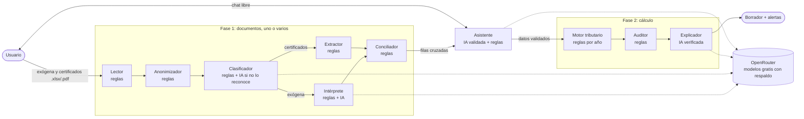

# DeclaraFácil AI

Asistente agéntico que convierte el reporte de **información exógena** de la DIAN y los **certificados** de cada persona (ingresos y retenciones, banco, vivienda, prepagada…) en un **borrador de la declaración de renta** de personas naturales residentes en Colombia (formulario 210, años gravables 2021 a 2025), explicado en lenguaje simple y con cada cifra trazable hasta su origen.

Proyecto del curso *Problem Discovery & Solution Design with AI*, Ingeniería de Sistemas, Universidad Católica de Colombia.

> Es un prototipo con fines educativos. No presenta la declaración ni reemplaza a un contador: la revisión y la firma en MUISCA siempre son del contribuyente.

## Qué hace

Todo pasa en un **chat a pantalla completa** con un agente. El usuario lleva la conversación de inicio a fin: el agente no sugiere preguntas ni guía con un cuestionario, responde lo que se le pregunta y hace lo que se le pide.

- Responde directo, incluso lo más básico ("¿qué es la DIAN?", "¿cómo sé si tengo que declarar?", "¿me pueden meter a la cárcel?"), sin haber subido nada. Las respuestas usan las cifras del año elegido.
- Si el usuario cuenta sus datos con sus palabras ("gano 4 millones al mes", "tengo 2 hijos", "un carro de 40 millones"), el agente los anota, muestra qué anotó y deja deshacerlo.
- Si pide calcular ("calcula", "¿cuánto me toca pagar?"), calcula ahí mismo. Si después cambia un dato o el año, el agente actualiza el cálculo solo.
- **Cuadro de preguntas arriba de la barra del chat** (como cuando Claude pregunta): las preguntas no van mezcladas en el texto; aparecen en un cuadro con respuestas numeradas para tocar, un campo para escribir otra respuesta, el paso ("1 de 2") y "Calcular con lo que hay". Primero salen los datos de la exógena por confirmar y luego lo que pregunta el agente.
- **La IA lee la exógena como tabla markdown** (entidad, concepto, valor, a dónde va y cómo se usa), ya procesada por el código; nunca lee el Excel.
- **Datos dudosos de la exógena, en preguntas sencillas**: una a la vez, con dos o tres respuestas cortas, la recomendada marcada y un "No sé" (por ejemplo: "¿Ese CDT seguía abierto el 31 de diciembre?"). Lo que se puede decidir con reglas no se pregunta: los bonos de alimentación no son ingreso si el salario no pasa de 310 UVT al mes y los bonos de 41 UVT (art. 387-1 ET), y un CDT abierto en el año no se suma si el banco ya reporta su saldo a 31 de diciembre.
- **Deduce de la exógena apenas se sube**: quién le reportó qué (empleador, bancos, créditos, fondo de cesantías, catastro), si está obligado y por qué, y qué beneficios ya vienen incluidos (retenciones, prepagada, intereses de vivienda, 1 % de facturas). Si algo no cuadra (por ejemplo, consignaciones muy por encima de los ingresos), pregunta de dónde salió la diferencia.
- **Pregunta cuando le falta información**, como un contador, solo cuando el dato cambia la respuesta y sin preguntar lo que ya trae la exógena:
  - Lo que la exógena no muestra: personas a cargo, aportes voluntarios, vehículos, ingresos que no pasan por un banco o un empleador, ventas, herencias o premios, sanciones previas, el impuesto del año pasado.
  - Cifras ambiguas: "gano 3 millones y medio" → "¿al mes o en todo el año?"; "tengo un carro" → "¿cuánto pagaste?"; "tengo hijos" → "¿cuántos?"; "vendí el lote en 80 millones" → "¿en cuánto lo habías comprado?" (la ganancia la calcula el código).
  - Antes de calcular hace como máximo dos rondas de preguntas (hasta dos datos cada una). Con "calcula así" calcula con lo que hay; el resultado dice qué supuso.
  - Si pregunta por su caso ("¿tengo que declarar?", "¿cuándo vence?") y falta el dato, lo pide y retoma. Nunca repite una pregunta; entiende respuestas cortas ("2", "al mes", "no", "no sé", "fue un préstamo").
- **Guía para conseguir cada dato**: "¿qué documentos necesito?" da la lista de SU caso con los nombres de sus entidades; "¿qué me falta?" dice lo que falta y empieza a preguntarlo; y explica cómo sacar cada certificado (220, tributario del banco, intereses de vivienda, prepagada, cesantías, pensión, predial, declaración anterior, soportes de dependientes).
- Simula escenarios sin tocar los datos: "¿y si pagara prepagada de 400 mil al mes?" → cuánto cambia el impuesto.
- Corrige: "quita la moto", "me equivoqué, no son 2 hijos" y cada cambio se puede deshacer.
- Si pregunta por su caso ("¿tengo que declarar?", "¿cuándo vence?") y ya hay datos, responde con su caso: la obligación la decide el motor con sus cifras y la fecha sale de su cédula.
- **Varios documentos a la vez**: con el clip (o arrastrando) sube de una vez la exógena y sus certificados, y puede agregar más en cualquier momento. El agente reconoce cada uno: exógena, certificado de ingresos y retenciones (220), certificado tributario del banco, intereses de vivienda, medicina prepagada, aportes voluntarios o AFC, cesantías, retenciones de independientes, predial y la declaración del año anterior. Si no reconoce un documento, propone sus cifras y las pregunta una por una.
- **Cruza los documentos para no contar nada dos veces**: si un certificado y la exógena traen el mismo dato de la misma entidad, usa el del certificado (la fuente directa) y avisa si no coinciden ("Retención de tu empleador: la exógena dice $2.100.000 y el certificado $2.350.000"). También dice qué trajo el certificado que la exógena no tenía, no vuelve a leer un archivo repetido y usa lo que el documento deja ver: el dependiente que registra el 220, el impuesto y el anticipo de la declaración anterior.
- Si los documentos son de otro año, el agente cambia a las reglas de ese año.
- Puede cambiar de año gravable (2021 a 2025) desde el selector de arriba o pidiéndolo en el chat.
- "Tus datos" abre un panel con cada cifra y de dónde sale.

Recibe: si está obligado a declarar, el saldo a pagar o a favor, la sanción si va tarde, alertas antes de firmar y el borrador en dos vistas:

- **Formulario 210 casilla por casilla** (años gravables 2023 a 2025): cada valor en su casilla con la numeración y las fórmulas del formulario oficial (Resolución DIAN 000044 de 2024, instructivo modificado por la 000120 de 2024), en el orden de MUISCA. Marca qué casillas se escriben y cuáles calcula la DIAN sola (con su fórmula), deja copiar cada valor (o todos), muestra de qué documento sale cada cifra y oculta las que van en cero. Los valores van aproximados a miles y los totales se recalculan desde las casillas ya aproximadas, como hace MUISCA, para que lo que se copia cuadre. Para 2021 y 2022 el formulario tenía otra numeración y se usa la vista por secciones.
- **Explicado por secciones**, con la norma de cada línea y las filas de la exógena o del certificado de donde sale.

Cubre la cédula general por subcédula como el formulario (rentas de trabajo, trabajo sin relación laboral con costos, capital y no laborales), con cada renta exenta y deducción imputada a su subcédula y el límite del 40 % repartido en el orden del instructivo; pensiones; dividendos (subcédulas 1 y 2, impuesto del art. 240 y descuento del art. 254-1); ganancias ocasionales; patrimonio; descuento por donaciones (arts. 257 y 258); anticipo (art. 807) y sanción por extemporaneidad (arts. 639-641). Beneficios incluidos: 25 % exento, cesantías según el salario, aportes voluntarios y AFC, intereses de vivienda, intereses del ICETEX (hasta 100 UVT), dependientes (10 % y 72 UVT adicionales), medicina prepagada, 50 % del 4x1000, 1 % de compras con factura electrónica y gastos de los inmuebles que se arriendan. Para independientes elige solo lo más favorable entre restar costos (casilla 43) o el 25 % exento (casilla 32).

## Arquitectura: un agente, una responsabilidad



| Agente | Usa IA | Responsabilidad única |
|---|---|---|
| Lector | No | Lee cada Excel o PDF: las filas de la exógena (detalle, valor, renglón sugerido) y el texto y las tablas de los certificados. |
| Anonimizador | No | Enmascara cédula, nombres, direcciones y cuentas de cada documento antes de que algo salga del servidor. Del dependiente del 220 solo queda el parentesco. |
| Clasificador | Solo si no lo reconoce | Identifica qué documento es y de qué año. Si las reglas no lo reconocen, le envía al modelo solo títulos, sin cifras ni datos personales. |
| Intérprete | Sí, acotada | Ubica cada concepto de la exógena en la declaración y lo explica. **Nunca recibe montos**: elige una casilla de una lista cerrada y el código copia la cifra de la fila original. |
| Extractor | No | Saca las cifras de los certificados con reglas por tipo: las casillas del 220 por su título; en banco, vivienda, prepagada, aportes y cesantías, el concepto (saldo, intereses, retención, 4x1000…) y el producto (cuenta, CDT, crédito, tarjeta). No cuenta totales encima del detalle. |
| Conciliador | No | Cruza todos los documentos: el certificado reemplaza a la exógena en el mismo dato de la misma entidad (por NIT o nombre), las cesantías del 220 reemplazan las del fondo, un CDT por confirmar se resuelve con los saldos del banco y un predial igual al avalúo de la exógena no se suma dos veces. Avisa cada diferencia. |
| Motor tributario | No | Liquida la declaración con las reglas del año (UVT, topes, art. 241, límite del 40 % / 1.340 UVT, etc.) y arma el formulario 210 casilla por casilla. |
| Auditor | No | Detecta datos por confirmar, ingresos menores a los reportados, patrimonio, vencimientos y beneficios no usados. |
| Explicador | Sí | Redacta el resumen. Cada cifra que escribe se compara contra el cálculo; si inventa una, se descarta y se usa la plantilla. |
| Asistente | Sí | El agente del chat: responde con la base de conocimiento completa (`backend/data/conocimiento`, con las cifras del año elegido) y decide la acción que pide el usuario (anotar, calcular, cambiar de año, abrir la carga de la exógena). La IA solo propone; el código valida cada dato (lista cerrada de campos y rangos, **cada monto anotado debe aparecer en el mensaje del usuario** y **cada cifra de la respuesta debe estar en los datos que recibió**; si no, se descarta). Sin IA o sin cupo, sigue funcionando con reglas. |

El **orquestador** (`backend/app/orquestador.py`) es un flujo fijo y trazable: cada agente emite eventos en vivo (Server-Sent Events) que el front muestra como sellos.

### Decisiones de diseño (ética y riesgo)

- **La IA no calcula.** El mayor riesgo identificado en la evaluación ética era que la IA inventara un valor y el usuario lo firmara. Por eso todas las cifras salen de reglas y de las filas originales.
- **Privacidad (Ley 1581).** Los archivos se procesan en memoria y no se guardan. A los modelos solo llegan descripciones de conceptos sin montos ni datos personales. Los proveedores gratuitos de OpenRouter pueden entrenar con lo que reciben; por eso el Anonimizador va antes de cualquier llamada.
- **Revisión humana obligatoria.** Lo que las reglas no reconocen o lo que ubica la IA queda marcado para que el usuario lo confirme.
- **El certificado manda.** Cuando dos documentos traen el mismo dato, se usa la fuente directa (el certificado de la entidad) y la exógena queda como referencia; las diferencias se muestran, no se esconden.
- **Reglas por año, no en el código.** `backend/data/reglas/agAAAA.json` guarda UVT, topes, tablas, límites, tarifas, calendario de vencimientos y sanciones. Para un año nuevo se clona el anterior desde la pantalla *Reglas y agentes*.
- **Modelos intercambiables.** `backend/data/agentes.json` define los modelos de cada agente en orden de preferencia. Si uno falla o llega al límite, pasa al siguiente. Se cambian desde la pantalla sin volver a desplegar.

## Estructura

```
backend/
  app/agents/       un archivo por agente (el Asistente usa conocimiento.py para la base por año y diagnostico.py para deducir y saber qué falta)
  app/tax/          motor tributario, formulario 210 casilla por casilla y modelos (sin IA)
  app/llm/          cliente de OpenRouter con respaldo entre modelos
  app/orquestador.py
  app/routers/api.py
  data/reglas/      ag2021 a ag2025 (vigentes), ag2026 (borrador)
  data/uvt.json     UVT de cada año (para la sanción según el año en que se presenta)
  data/agentes.json modelos y temperatura por agente
  data/conocimiento base de conocimiento del Asistente
  data/demo/        exógena y certificados ficticios (220 y banco) para probar
  tests/            137 pruebas (motor por año, formulario 210 casilla por casilla, agentes, certificados y cruce de documentos, conversaciones del chat, API, ruta con IA simulada)
  scripts/          generadores de la exógena y los certificados demo y de las reglas 2021-2024
frontend/           React + Vite + TypeScript, animaciones con Motion
Dockerfile          construye el front y lo sirve desde FastAPI
render.yaml         despliegue gratuito en Render
```

## Correr en local

Requisitos: Python 3.12+ y Node 20+.

```bash
# Backend
cd backend
python -m venv .venv && source .venv/bin/activate   # en Windows: .venv\Scripts\activate
pip install -r requirements-dev.txt
export OPENROUTER_API_KEY=sk-or-...                  # opcional; sin llave funciona en modo simulado
uvicorn app.main:app --reload --port 8000

# Front (otra terminal)
cd frontend
npm install
npm run dev        # http://localhost:5173, redirige /api al backend
```

Pruebas: `cd backend && pytest`. Para regenerar la exógena ficticia: `python scripts/generar_exogena_demo.py`.

## Desplegar gratis (Render + OpenRouter)

1. Crea una cuenta en [openrouter.ai](https://openrouter.ai) y genera una API key en *Keys*. No necesitas tarjeta.
2. Entra a [render.com](https://render.com) con tu cuenta de GitHub.
3. *New* → *Blueprint* → elige este repositorio. Render lee `render.yaml`.
4. Cuando lo pida, pega tu llave en `OPENROUTER_API_KEY`. `ADMIN_TOKEN` se genera solo: búscalo en *Environment* del servicio; es la clave para editar reglas y agentes.
5. *Apply*. La primera construcción tarda unos minutos. La app queda en `https://<nombre>.onrender.com`.

Límites a tener en cuenta:

- **Render gratis** apaga el servicio tras 15 minutos sin uso; la primera visita después tarda cerca de un minuto. Ábrelo antes de presentar.
- **OpenRouter gratis** permite 20 solicitudes por minuto y 50 al día sin créditos (1.000 al día si se compran 10 USD una vez). Cada análisis usa de 1 a 3 llamadas y **cada mensaje del chat usa una**. Cuando se acaba el cupo, el chat sigue respondiendo con reglas y la base de conocimiento.
- Modelos por defecto (revisados el 1 de noviembre de 2026): `nvidia/nemotron-3-ultra-550b-a55b:free`, `nvidia/nemotron-3.5-lightning:free` y `nvidia/nemotron-3.5-super-vl:free`, con `openrouter/free` de respaldo. Gemma 4 devolvía 429 de su proveedor, Inkling solo funciona con herramientas de agente y Nemotron 3 Super dejó de ser gratis.
- Casi todos los modelos gratis razonan antes de responder y ese razonamiento gasta tokens. Por eso cada agente pide razonamiento corto y oculto (`"razonamiento": "low"` en `agentes.json`); si un proveedor no acepta el parámetro, se reintenta sin él.
- Los modelos `:free` cambian seguido. En *Reglas y agentes* → *Agentes* → *Consultar OpenRouter* ves los disponibles hoy y los reemplazas. `openrouter/free` funciona como último respaldo.
- Lo que se edite desde la pantalla de configuración dura hasta que el servicio se reinicie. Para dejarlo fijo, descarga el JSON y súbelo al repositorio.

## Alcance y supuestos

- Personas naturales **residentes**, no obligadas a llevar contabilidad.
- No cubre: rentas del exterior, régimen SIMPLE, descuento por donaciones, renta presuntiva (0 % desde 2021) ni el cálculo de renta por comparación patrimonial (el Auditor solo la advierte).
- Años 2021 y 2022 usan las reglas anteriores a la Ley 2277 (límite de 5.040 UVT, renta exenta de 2.880 UVT, dividendos con tabla propia, ganancias ocasionales al 10 %). Los vencimientos de los años 2021 a 2024 se generaron con la regla de cada decreto de calendario (el método reproduce el calendario oficial 2026); conviene revisarlos contra el calendario publicado.
- La sanción se estima con la reducción del art. 640 si el usuario indica que no ha sido sancionado en los últimos dos años; no incluye intereses de mora.
- Los renglones R29, R30, R32 y R132 que se mencionan vienen de la columna *Uso declaración sugerida* de la propia exógena.
- La DIAN no recibe archivos de terceros para el 210: se diligencia en su formulario virtual en MUISCA (versión para expertos) y se firma ahí. La vista casilla por casilla es para copiar esos valores; no es un documento oficial. No cubre casillas de rentas del exterior, ECE, compensaciones de pérdidas, rentas gravables por comparación patrimonial (el Auditor la advierte) ni el aporte voluntario del art. 244-1.
- Los certificados se leen con reglas sobre su texto: funcionan con los PDF que descargan las entidades (con texto), no con fotos ni escaneos. Los formatos de cada banco varían; lo que no se reconoce con seguridad se pregunta antes de usarlo. Los certificados de ejemplo son ficticios y se generan con `scripts/demo_certificados.py`.

## Fuentes normativas

Estatuto Tributario (arts. 119, 206, 241, 242, 254-1, 257, 258, 259, 307, 311-1, 314, 317, 331, 336, 387, 639-641, 807); Ley 2277 de 2022; Ley 2380 de 2024 (donaciones de alimentos); Resolución DIAN 000044 de 2024 (formulario 210 para el año gravable 2023 y siguientes) y Resolución 000120 de 2024 (instructivo), compiladas en la Resolución Única 000227 de 2025; resoluciones DIAN de UVT de cada año (2021: $36.308; 2022: $38.004; 2023: $42.412; 2024: $47.065; 2025: $49.799); Resolución DIAN 000238 de 2025 (UVT 2026: $52.374); Decreto 0898 de 2026 (componente inflacionario AG 2025: 55,43 %); Decreto 2229 de 2023 (calendario tributario); calendario 2026 para personas naturales.
