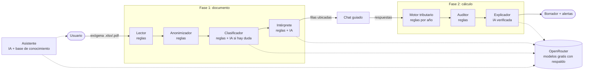

# DeclaraFácil AI

Asistente agéntico que convierte el reporte de **información exógena** de la DIAN en un **borrador de la declaración de renta** de personas naturales en Colombia (año gravable 2025), explicado en lenguaje simple y con cada cifra trazable hasta su origen.

Proyecto del curso *Problem Discovery & Solution Design with AI*, Ingeniería de Sistemas, Universidad Católica de Colombia.

> Es un prototipo con fines educativos. No presenta la declaración ni reemplaza a un contador: la revisión y la firma en MUISCA siempre son del contribuyente.

## Qué hace

1. El usuario sube el Excel (o PDF) de exógena que descarga de MUISCA.
2. Un chat guiado le pide solo lo que la exógena no trae: dependientes, gastos deducibles, otros ingresos, bienes y su historial con la DIAN.
3. Recibe: si está obligado a declarar, el saldo a pagar o a favor, la sanción si va tarde, alertas antes de firmar, el borrador por cédulas y, al tocar cada línea, la norma y las filas de la exógena de donde sale.

Cubre la cédula general (trabajo, honorarios, capital y no laborales), pensiones, dividendos (subcédulas 1 y 2 con el descuento del art. 254-1), ganancias ocasionales, patrimonio, anticipo (art. 807) y sanción por extemporaneidad (arts. 639-641).

## Arquitectura: un agente, una responsabilidad



| Agente | Usa IA | Responsabilidad única |
|---|---|---|
| Lector | No | Lee el Excel o PDF y lo convierte en filas (detalle, valor, renglón sugerido). |
| Anonimizador | No | Enmascara cédula, nombres y cuentas antes de que algo salga del servidor. |
| Clasificador | Solo si hay duda | Confirma que el archivo es una exógena y de qué año. |
| Intérprete | Sí, acotada | Ubica cada concepto en la declaración y lo explica. **Nunca recibe montos**: elige una casilla de una lista cerrada y el código copia la cifra de la fila original. |
| Motor tributario | No | Liquida la declaración con las reglas del año (UVT, topes, art. 241, límite del 40 % / 1.340 UVT, etc.). |
| Auditor | No | Detecta datos por confirmar, ingresos menores a los reportados, patrimonio, vencimientos y beneficios no usados. |
| Explicador | Sí | Redacta el resumen. Cada cifra que escribe se compara contra el cálculo; si inventa una, se descarta y se usa la plantilla. |
| Asistente | Sí | Responde dudas con una base de conocimiento propia (`backend/data/conocimiento`). |

El **orquestador** (`backend/app/orquestador.py`) es un flujo fijo y trazable: cada agente emite eventos en vivo (Server-Sent Events) que el front muestra como sellos.

### Decisiones de diseño (ética y riesgo)

- **La IA no calcula.** El mayor riesgo identificado en la evaluación ética era que la IA inventara un valor y el usuario lo firmara. Por eso todas las cifras salen de reglas y de las filas originales.
- **Privacidad (Ley 1581).** El archivo se procesa en memoria y no se guarda. A los modelos solo llegan descripciones de conceptos sin montos ni datos personales. Los proveedores gratuitos de OpenRouter pueden entrenar con lo que reciben; por eso el Anonimizador va antes de cualquier llamada.
- **Revisión humana obligatoria.** Lo que las reglas no reconocen o lo que ubica la IA queda marcado para que el usuario lo confirme.
- **Reglas por año, no en el código.** `backend/data/reglas/agAAAA.json` guarda UVT, topes, tablas, límites, tarifas, calendario de vencimientos y sanciones. Para un año nuevo se clona el anterior desde la pantalla *Reglas y agentes*.
- **Modelos intercambiables.** `backend/data/agentes.json` define los modelos de cada agente en orden de preferencia. Si uno falla o llega al límite, pasa al siguiente. Se cambian desde la pantalla sin volver a desplegar.

## Estructura

```
backend/
  app/agents/       un archivo por agente
  app/tax/          motor tributario y modelos (sin IA)
  app/llm/          cliente de OpenRouter con respaldo entre modelos
  app/orquestador.py
  app/routers/api.py
  data/reglas/      ag2025.json (vigente), ag2026.json (borrador)
  data/agentes.json modelos y temperatura por agente
  data/conocimiento base de conocimiento del Asistente
  data/demo/        exógena ficticia para probar
  tests/            35 pruebas (motor, agentes, API, ruta con IA simulada)
frontend/           React + Vite + TypeScript, animaciones con Motion
Dockerfile          construye el front y lo sirve desde FastAPI
render.yaml         despliegue gratuito en Render
```

## Correr en local

Requisitos: Python 3.12+ y Node 20+.

```bash
# Backend
cd backend
python -m venv .venv && source .venv/bin/activate   # en Windows: .venv\Scripts\activate
pip install -r requirements-dev.txt
export OPENROUTER_API_KEY=sk-or-...                  # opcional; sin llave funciona en modo simulado
uvicorn app.main:app --reload --port 8000

# Front (otra terminal)
cd frontend
npm install
npm run dev        # http://localhost:5173, redirige /api al backend
```

Pruebas: `cd backend && pytest`. Para regenerar la exógena ficticia: `python scripts/generar_exogena_demo.py`.

## Desplegar gratis (Render + OpenRouter)

1. Crea una cuenta en [openrouter.ai](https://openrouter.ai) y genera una API key en *Keys*. No necesitas tarjeta.
2. Entra a [render.com](https://render.com) con tu cuenta de GitHub.
3. *New* → *Blueprint* → elige este repositorio. Render lee `render.yaml`.
4. Cuando lo pida, pega tu llave en `OPENROUTER_API_KEY`. `ADMIN_TOKEN` se genera solo: búscalo en *Environment* del servicio; es la clave para editar reglas y agentes.
5. *Apply*. La primera construcción tarda unos minutos. La app queda en `https://<nombre>.onrender.com`.

Límites a tener en cuenta:

- **Render gratis** apaga el servicio tras 15 minutos sin uso; la primera visita después tarda cerca de un minuto. Ábrelo antes de presentar.
- **OpenRouter gratis** permite 20 solicitudes por minuto y 50 al día sin créditos (1.000 al día si se compran 10 USD una vez). Cada análisis usa de 1 a 3 llamadas.
- Los modelos `:free` cambian seguido. En *Reglas y agentes* → *Agentes* → *Consultar OpenRouter* ves los disponibles hoy y los reemplazas. `openrouter/free` funciona como último respaldo.
- Lo que se edite desde la pantalla de configuración dura hasta que el servicio se reinicie. Para dejarlo fijo, descarga el JSON y súbelo al repositorio.

## Alcance y supuestos

- Personas naturales **residentes**, no obligadas a llevar contabilidad.
- No cubre: rentas del exterior, régimen SIMPLE, descuento por donaciones, renta presuntiva (0 % desde 2021) ni el cálculo de renta por comparación patrimonial (el Auditor solo la advierte).
- Deducciones y rentas exentas se agregan para toda la cédula general (no se reparten por subcédula como en el formulario).
- La sanción se estima con la reducción del art. 640 si el usuario indica que no ha sido sancionado en los últimos dos años; no incluye intereses de mora.
- Los renglones R29, R30, R32 y R132 que se mencionan vienen de la columna *Uso declaración sugerida* de la propia exógena.

## Fuentes normativas

Estatuto Tributario (arts. 206, 241, 242, 254-1, 307, 311-1, 314, 317, 331, 336, 387, 639-641, 807); Ley 2277 de 2022; Resolución DIAN 000193 de 2024 (UVT 2025: $49.799); Resolución DIAN 000238 de 2025 (UVT 2026: $52.374); Decreto 0898 de 2026 (componente inflacionario AG 2025: 55,43 %); calendario tributario 2026 para personas naturales.
